# Minimal Text AI

**English** · [简体中文](README.zh-CN.md)

[](https://obsidian.md/)
[](https://github.com/huasanai/minimal-text-ai/releases/latest)
[](LICENSE)



Format, polish, and translate Markdown in the Obsidian editor. Review wording changes inline before applying them. Formatting-only edits apply automatically.


## Features

- Format a selection or the whole note. Polish or translate selected text.
- Jump between changes in the inline diff. Press `Enter` to apply or `Esc` to discard.
- Switch between DeepSeek, Gemini, local Ollama, or a custom OpenAI-compatible endpoint from the desktop status bar or command palette.
- Customize command prompts and assign hotkeys.
- Open the AI edit history from the editor context menu to compare changes, copy the original text, or revert an edit when the note still matches that revision.


## Installation

1. Download `main.js`, `manifest.json`, and `styles.css` from the [latest release](https://github.com/huasanai/minimal-text-ai/releases/latest).
2. Place the three files in `.obsidian/plugins/minimal-text-ai/` inside your vault. If your vault uses a custom configuration folder, use that folder in place of `.obsidian`.
3. In Obsidian, open **Settings → Community plugins** and enable **Minimal Text AI**. Reload Obsidian if the plugin does not appear.

## Usage

1. Open **Settings → Minimal Text AI**, choose a model, and enter its API key or configure a local endpoint.
2. Select text and run a command from the editor context menu or command palette. The formatting command uses the whole note when no text is selected. Built-in command labels are displayed in Chinese.
3. If an inline diff appears, review the changes and press `Enter` to apply or `Esc` to discard.

## Edits and data

The inline preview uses CodeMirror decorations. When you apply a change, the plugin saves the original text and makes one editor edit that you can undo with `Cmd/Ctrl + Z`. Edit history is stored in `minimal-text-ai-history/` inside your vault's configuration folder. API keys are stored in the plugin's local `data.json`.

Each command sends the selected text or note and its prompt to the configured model endpoint. The DeepSeek and Gemini presets use `api.deepseek.com` and `generativelanguage.googleapis.com`, respectively. Both require a provider account and API key. Charges and data handling depend on the provider. The same applies to custom remote endpoints.

The plugin is free. With Ollama running on your device, requests stay on that device and require no remote account.

## Build from source

```bash
npm ci
npm run build
```

The build produces `main.js`. Install it with the repository's `manifest.json` and `styles.css` using the steps above.

## Feedback and support

To report a problem, open an [issue](https://github.com/huasanai/minimal-text-ai/issues) with your Obsidian version and steps to reproduce it.

HuaSan · WeChat `huasanai` · [X @yfusionai](https://x.com/yfusionai) · [Douyin](https://v.douyin.com/zHu4VUhztes/)

If the plugin saves you time, you can support it by scanning the QR code below.


## License

The project is licensed under [MIT](LICENSE). The bundled fast-diff dependency is licensed under [Apache-2.0](THIRD-PARTY-LICENSES.txt).
