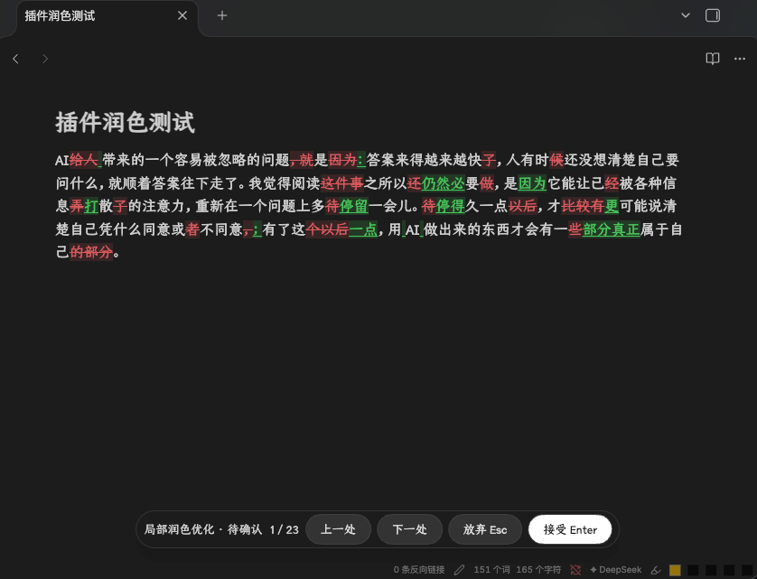
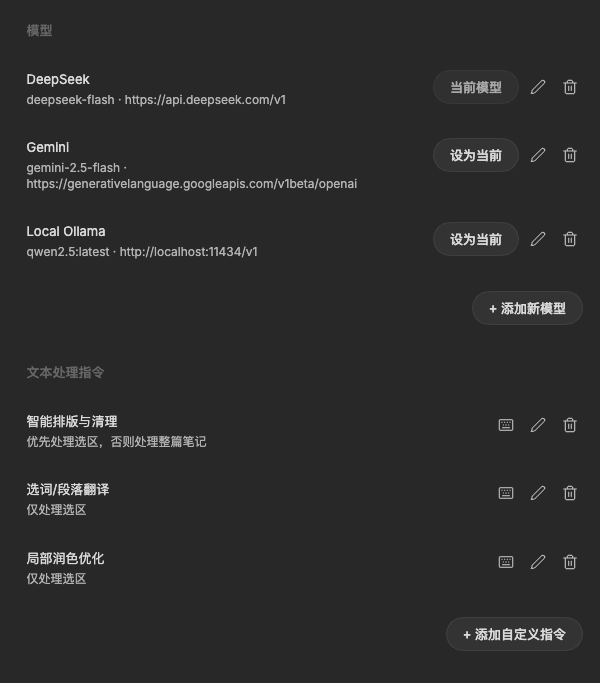

# Minimal Text AI

[](https://obsidian.md/)
[](https://github.com/huasanai/minimal-text-ai/releases/latest)
[](LICENSE)


Minimal Text AI formats, polishes, and translates Markdown in the Obsidian editor. Review wording changes inline before applying them. Formatting-only edits are applied automatically. Use DeepSeek, Gemini, local Ollama, or a custom OpenAI-compatible endpoint.

## Installation

1. Download `main.js`, `manifest.json`, and `styles.css` from the [latest GitHub release](https://github.com/huasanai/minimal-text-ai/releases/latest).
2. In your vault, create `.obsidian/plugins/minimal-text-ai/` and place the three files there. If your vault uses a custom configuration folder, use that folder in place of `.obsidian`.
3. In Obsidian, go to **Settings → Community plugins** and enable **Minimal Text AI**. Reload Obsidian if the plugin does not appear.

## Usage

1. Open **Settings → Minimal Text AI**, choose a model, and set its API key or local endpoint.
2. Select text and run a command from the editor context menu or the command palette. The built-in formatting command can also run on the whole note when no text is selected. The built-in editor commands appear in Chinese as **智能排版与清理** (Format and Clean), **局部润色优化** (Polish Selection), and **选词/段落翻译** (Translate Selection).
3. For wording changes, review the inline diff. Press `Enter` to apply or `Esc` to discard.

Each command sends the selected text or note and its prompt to the configured model endpoint. DeepSeek and Gemini require a provider account and API key and may charge for usage. With a local Ollama endpoint, requests stay on your device. Edit history and API keys are stored in your vault's configuration folder.

在 Obsidian 编辑器里排版、润色和翻译。改动有文字增删时，先在原位看清差异，再决定是否写入。



## 能做什么

- **排版与清理**：处理选区或整篇笔记。模型结果只有格式调整时直接应用。
- **润色与翻译**：先选中文字，再从右键菜单或命令面板执行。支持自定义指令、提示词和快捷键。
- **原位审阅**：文字改动显示删除线和新增高亮。可跳到上一处或下一处，按 `Enter` 接受或 `Esc` 放弃。
- **切换模型**：预设 DeepSeek、Gemini 和本地 Ollama。也可添加 OpenAI 兼容接口，用桌面状态栏或命令面板切换。
- **找回修改前的内容**：右键打开「查看 AI 修改历史」，可对比、复制原文或撤回符合条件的改动。



## 安装与使用

1. 打开 [Releases](https://github.com/huasanai/minimal-text-ai/releases/latest)，下载 `main.js`、`manifest.json` 和 `styles.css`。
2. 将三个文件放进笔记库的 `.obsidian/plugins/minimal-text-ai/`。如果你改过 Obsidian 配置目录，请使用对应目录。
3. 在 Obsidian「设置 → 第三方插件」启用 **Minimal Text AI**。
4. 在插件设置里填写模型 API Key 或配置本地模型。选中文字后，从编辑器右键菜单运行指令。

## 写入与数据

预览通过 CodeMirror 装饰渲染。接受修改后，插件先保存原文，再执行一次原生编辑，可用 `Cmd/Ctrl + Z` 撤销。修改历史留在笔记库配置目录的 `minimal-text-ai-history/`。

运行指令时，插件将选区或当前笔记及对应的提示词发送到你选择的模型接口，用于排版、润色或翻译。预设的 DeepSeek 与 Gemini 分别连接 `api.deepseek.com` 和 `generativelanguage.googleapis.com`，这两种服务需要各自的账号和 API Key，并可能按服务商的规则收费。自定义接口按该服务的规则处理文本和计费。

插件本身可免费使用。使用本机 Ollama 时，文本只发送到本机配置的模型接口，运行时无需远程账号。API Key 保存在当前笔记库的插件配置 `data.json` 中。

## 从源码构建

```bash
npm ci
npm run build
```

构建生成 `main.js`。用它和仓库里的 `manifest.json`、`styles.css` 按上面的方式安装。

## 反馈与交流

遇到问题可以提 [Issue](https://github.com/huasanai/minimal-text-ai/issues)，附上 Obsidian 版本和复现步骤。

画伞 · 微信 `huasanai` · [X @yfusionai](https://x.com/yfusionai) · [抖音 @画伞](https://v.douyin.com/zHu4VUhztes/)

### 支持开源创作

如果这个插件帮你节省了时间，欢迎扫码支持。


## 许可证

项目源码采用 [MIT](LICENSE)。构建中包含的 fast-diff 采用 [Apache-2.0](THIRD-PARTY-LICENSES.txt)。
